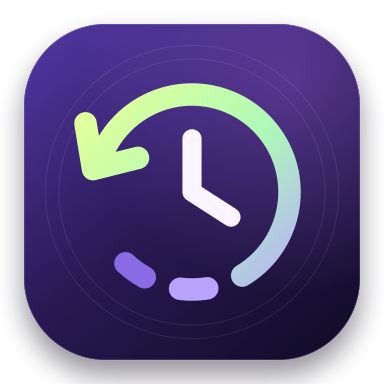
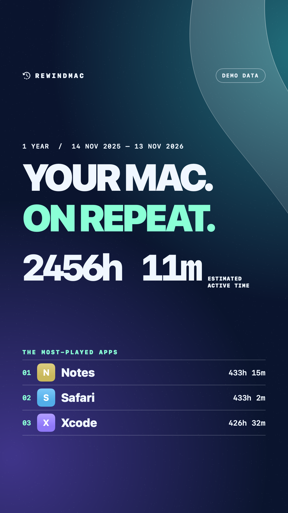
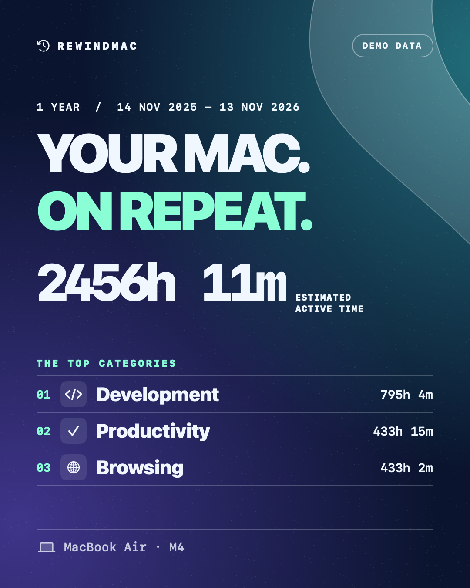

<p align="center">
  
</p>

<h1 align="center">RewindMac</h1>

<p align="center">
  Rekap penggunaan aplikasi di Mac dari riwayat Screen Time.
  Lihat pola penggunaanmu dan ubah rekapnya jadi poster untuk dibagikan.
</p>

<p align="center">
  <strong><a href="https://github.com/Fikriazrbni/RewindMac/releases/download/v1.4.6/RewindMac.zip">Unduh RewindMac v1.4.6 (.zip)</a></strong><br>
  macOS 14+ · Apple silicon (seri M)
</p>

<p align="center">
  <a href="#install">Install</a> ·
  <a href="#impor-screen-time">Impor Screen Time</a> ·
  <a href="#pakai-rewindmac">Pakai RewindMac</a> ·
  <a href="#bagikan-poster">Bagikan poster</a> ·
  <a href="#privasi">Privasi</a>
</p>

<p align="center">
  <a href="docs/Demo-recap.png"></a>
  <a href="docs/Demo-feed.png"></a>
</p>

<p align="center">Klik poster untuk melihat PNG ukuran penuh. Keduanya memakai data demo.</p>

## Install

1. [Unduh RewindMac.zip](https://github.com/Fikriazrbni/RewindMac/releases/download/v1.4.6/RewindMac.zip) dari [release v1.4.6](https://github.com/Fikriazrbni/RewindMac/releases/tag/v1.4.6). Kamu bisa mengunduhnya tanpa login GitHub.
2. Ekstrak ZIP, pindahkan **RewindMac.app** ke **Applications**, lalu buka dari sana. Saat memperbarui, tutup aplikasi lama dengan **⌘Q** sebelum menggantinya.
3. Ikuti [langkah Full Disk Access](#impor-screen-time) jika ingin mengimpor riwayat dari Mac ini.

Paket ini dibuat untuk **Mac Apple silicon** dengan **macOS 14 atau lebih baru**. Aplikasi ditandatangani secara *ad hoc* dan belum dinotariskan. Jika macOS menahan pembukaan pertama karena aplikasi belum dinotariskan, lihat [panduan Apple untuk membuka aplikasi yang kamu percayai](https://support.apple.com/en-us/102445).

<details>
<summary>Build dari source, termasuk untuk Mac Intel</summary>

Siapkan Swift 6 dan macOS SDK dari Xcode atau Command Line Tools. Jalankan `xcode-select --install` jika belum punya toolchain. Build mengikuti arsitektur Mac yang menjalankannya.

```sh
git clone https://github.com/Fikriazrbni/RewindMac.git
cd RewindMac
./Scripts/build-app.sh
open dist
```

Pindahkan **RewindMac.app** dari folder **dist** ke **Applications**.

</details>

<details>
<summary>Build lewat Xcode dan menjalankan tes</summary>

Buka `Package.swift` di Xcode. Pilih skema **RewindMac** dengan tujuan **My Mac**, lalu pilih **Run**. Untuk membuat bundle aplikasi dengan ikon dan menjalankan aplikasi dari Finder, pakai `./Scripts/build-app.sh`.

Jalankan `./Scripts/test.sh` untuk menguji analitik, impor, dan ekspor PNG. Build debug tersedia lewat `./Scripts/build-app.sh debug`.

</details>

## Impor Screen Time

1. Buka **System Settings → Privacy & Security → Full Disk Access**.
2. Klik **+**, pilih **RewindMac.app** dari **Applications**, dan pastikan izinnya aktif. Pilih lokasi tempat kamu benar-benar menjalankan aplikasinya jika berbeda.
3. Tutup RewindMac dengan **⌘Q** lalu buka kembali.
4. Di **Overview** atau **Wrapped**, klik **Import Screen Time… → Read This Mac**.
5. Tinjau rentang tanggal dan durasi yang tersedia, lalu klik **Import**.

Ulangi langkah 4–5 untuk mengambil data baru. Impor melewati penggunaan yang sudah disimpan. Rentang **1 year** atau **Custom** menampilkan penggunaan yang tersedia di tanggal pilihanmu. Cakupan impor bergantung pada riwayat yang masih disimpan macOS.

<details>
<summary>Izin sudah aktif tapi muncul “Screen Time access blocked”</summary>

Build lokal menggunakan tanda tangan *ad hoc*, jadi izin lama bisa tidak cocok setelah update. Hapus entri lama di **Full Disk Access**, tambahkan bundle **RewindMac.app** yang sekarang dipakai, lalu tutup dan buka ulang aplikasi sebelum mencoba **Read This Mac** lagi.

Di dialog impor, **Open Full Disk Access** membuka pengaturan izin dan **Show RewindMac in Finder** menunjukkan bundle yang sedang dijalankan. Kalau punya cadangan KnowledgeC yang bisa dibaca, pilih **Choose KnowledgeC Backup…**.

</details>

## Pakai RewindMac

- **Overview** menampilkan aplikasi teratas, waktu per kategori, timeline, dan heatmap.
- **Wrapped** merangkum periode **7 days**, **1 month**, **3 months**, **1 year**, atau tanggal **Custom**. Pakai panah untuk melihat periode sebelumnya.
- **Settings → Explore demo mode** memungkinkan kamu mencoba dashboard, Wrapped, dan poster dengan data contoh. Data demo diberi label di poster.

## Bagikan poster

1. Buka **Wrapped**, pilih periodenya, lalu klik **Share recap**.
2. Pilih format **Story** (1080 × 1920) atau **Feed** (1080 × 1350).
3. Gabungkan **Template** seperti Classic, Top Five, Spotlight, atau By the Numbers dengan **Theme** seperti Aurora atau Graphite.
4. Pilih **Footer** untuk menampilkan ikon, Mac vibe, teks sendiri, atau model dan chip Mac yang terdeteksi otomatis. Pilih **None** untuk menyembunyikan footer. **Show Apple logo** menambahkan logo kecil di samping tulisan REWINDMAC.
5. Klik **Save PNG…**, lalu unggah file yang tersimpan ke Instagram sebagai Story atau posting Feed.

<details>
<summary>Pilihan tampilan dan contoh lainnya</summary>

| Kontrol | Pilihan |
| --- | --- |
| Template | Classic, Top Five, Spotlight, By the Numbers |
| Theme | Aurora, Graphite, Ultraviolet, Ember, Sea Glass, After Hours, Dayglow |
| Footer | None, App icons, Mac vibe, Mac model, Custom text |

Pada template yang mendukungnya, matikan **Show apps** untuk menampilkan kategori. Footer **Mac model** menampilkan satu baris seperti `MacBook Air · M4`. Lihat [contoh Feed dengan footer model Mac](docs/Demo-feed.png) dan [contoh Story](docs/Demo-recap.png).

</details>

## Privasi

RewindMac berjalan secara lokal dan mengimpor Screen Time saat kamu memintanya. Riwayat yang diimpor tersimpan di `~/Library/Application Support/RewindMac/activity.sqlite`. Pengaturan **Full Disk Access** diperlukan untuk membaca riwayat Screen Time langsung dari file sistem. Kamu memilih file PNG mana yang ingin dibagikan.

Baca [privasi dan izin](docs/PRIVACY.md), [arsitektur](docs/ARCHITECTURE.md), [validasi](docs/VALIDATION.md), dan [batasan](docs/LIMITATIONS.md).
